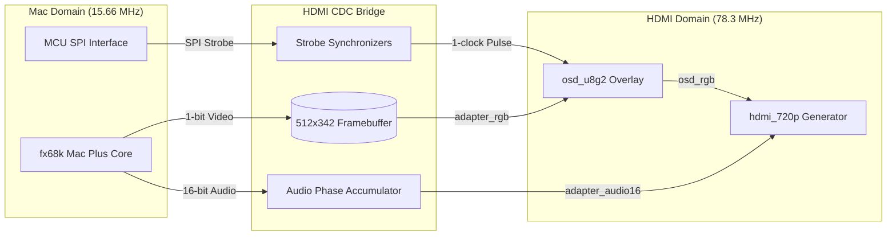
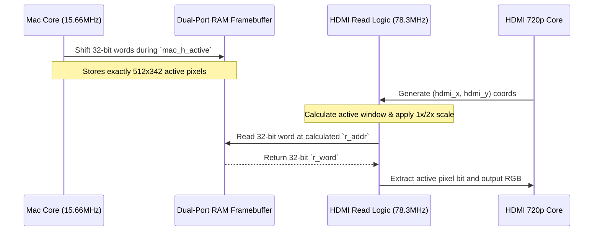
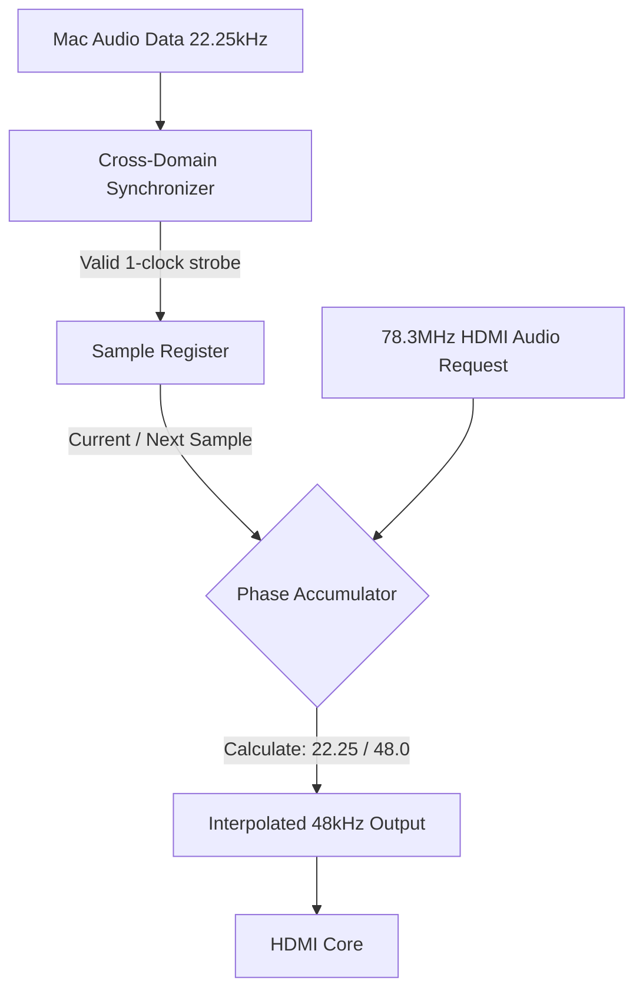

# NanoMac HDMI CDC Bridge Architecture

## 1. Executive Summary

NanoMac originally passed pixel data from the Mac's 15.66 MHz clock domain directly into a custom, non-standard HDMI generator (704x370 @ 60Hz). Our initial attempt to adapt this output to a standard 720p HDMI display relied on a small, asynchronous FIFO buffer constructed in Amaranth. This approach suffered from severe instability, clock drift, and frequent "no signal" dropouts on modern monitors due to buffer under-runs and phase mismatches.

The new **HDMI CDC (Clock Domain Crossing) Bridge** architecture resolves these issues by completely decoupling the Mac's video generation from the HDMI output. It introduces a full 512x342 dual-port RAM framebuffer and a standard 720p (1280x720) HDMI generator. This ensures perfect signal stability on modern displays while maintaining 100% accurate internal timings for the Mac core.

---

## 2. System Architecture Overview

The system is cleanly divided into two mathematically locked clock domains. Data crosses from the slow Mac domain into the fast HDMI domain via the CDC Bridge.

---

## 3. Clock Domains

- **Mac Clock (`clk_pixel`)**: Runs at **15.6672 MHz**. This is the native pixel clock of the original Mac Plus. All internal Mac state machines, CPU memory arbitration, and video shifting operate exclusively in this domain.
- **HDMI Clock (`clk_pixel_x5`)**: Runs at **78.336 MHz** (exactly 5x the Mac clock). This serves as the pixel clock for standard 720p60 output (which technically requires 74.25 MHz, but modern monitors easily accept 78.3 MHz within standard tolerances).

By maintaining an exact 1:5 ratio, we prevent long-term phase drift and simplify the synchronizer logic across the boundary.

---

## 4. Video Pipeline

Instead of streaming pixels on-the-fly, the Mac core writes active video into a dual-port Block RAM framebuffer. The HDMI generator reads from this buffer independently.

### Scaling Modes
The bridge includes a runtime-configurable `wide` parameter mapped to the OSD menu:
- **1x Scale (`wide=0`)**: The 512x342 Mac screen is rendered 1:1 in the exact center of the 1280x720 HDMI frame.
- **2x Scale (`wide=1`)**: The bridge divides the `hdmi_x` and `hdmi_y` read coordinates by 2, resulting in a perfect integer scale (1024x684) that fills most of the 720p screen while maintaining the Mac's native aspect ratio.

---

## 5. Audio Pipeline

The original Mac audio operates at ~22.25 kHz. The HDMI specification requires a standard audio rate (e.g., 48.0 kHz). The CDC bridge handles both the domain crossing and the sample rate conversion using a **Phase Accumulator**.

Because the HDMI audio packets are requested at 48kHz by the HDMI generator, the phase accumulator increments its fractional pointer by exactly `30385` (which is `22254.5 / 48000 * 65536`) on every HDMI request, guaranteeing pitch-perfect audio playback without FIFO overruns.

---

## 6. OSD Overlay

The On-Screen Display (`osd_u8g2`) was moved from the Mac domain into the HDMI domain so that it natively overlays the 720p output. 
- **Aspect Ratio Fix**: The MCU sends SPI data to the OSD using a strobe generated in the 15.66 MHz domain. To prevent the 78.3 MHz OSD from reading the same byte 5 times (which stretches the text horizontally), an edge-detector synchronizes the strobe into a single 1-clock pulse in the HDMI domain.
- **Positioning**: The OSD coordinates are locked directly to the `hdmi_cx` and `hdmi_cy` counters, ensuring it remains crisp and perfectly centered regardless of whether the underlying Mac video is in 1x or 2x scaling mode.
